# Mongo Manager

[](https://github.com/mongo-manager/mongo-manager/actions/workflows/ci.yml) [](https://www.npmjs.com/package/@mongo-manager/app) [](LICENSE) [](https://nodejs.org/)

[English](README.md) · [Türkçe](README.tr.md) · [简体中文](README.zh.md) · [日本語](README.ja.md) · [Español](README.es.md) · **Português (Brasil)** · [한국어](README.ko.md) · [Deutsch](README.de.md) · [Français](README.fr.md) · [Русский](README.ru.md)

**Um gerenciador de MongoDB seguro que roda no seu navegador, em um servidor hospedado por você.** Use sozinho ou com a sua equipe, deixe um agente de IA fazer o trabalho a partir das suas palavras e mantenha tudo totalmente offline.

<p align="center">
  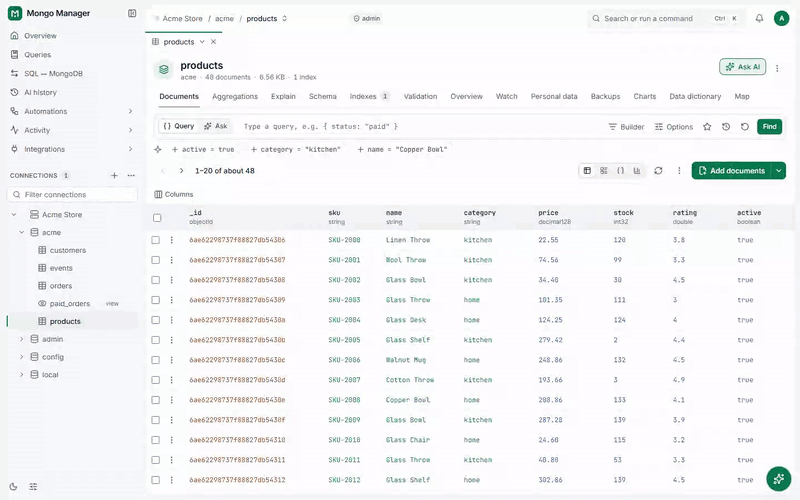
</p>
<p align="center"><a href="docs/media/demo.mp4">Assista à demonstração em qualidade total (MP4, 55 s)</a></p>

<p align="center">Feito por <b>Gokhan OZGEZER</b> · <a href="mailto:gokhanozgezer@gmail.com">gokhanozgezer@gmail.com</a> · <a href="https://github.com/gokhanozgezer">GitHub</a></p>

## Conteúdo

- [Por que o Mongo Manager](#por-que-o-mongo-manager)
- [Início rápido](#início-rápido)
- [Destaques](#destaques)
  - [Agente de IA](#agente-de-ia)
  - [Conjuntos de réplicas](#conjuntos-de-réplicas)
  - [Clusters fragmentados](#clusters-fragmentados)
  - [Equipes, segurança e auditoria](#equipes-segurança-e-auditoria)
  - [Backups, cópias e sincronização em tempo real](#backups-cópias-e-sincronização-em-tempo-real)
  - [Ocultar dados pessoais](#ocultar-dados-pessoais)
- [Todos os recursos](#todos-os-recursos)
- [Um tour rápido](#um-tour-rápido)
- [Capturas de tela](#capturas-de-tela)
- [Instalação](#instalação)
- [Uso](#uso)
- [Segurança](#segurança)
- [Desenvolvimento](#desenvolvimento)
- [Licença](#licença)
- [Autor](#autor)

## Por que o Mongo Manager

O MongoDB Compass é um app desktop para uma pessoa. O Mongo Manager roda uma vez em um servidor, toda a equipe o usa pelo navegador, e ele faz o que o Compass não faz:

|                             | Mongo Manager                                                                                     | MongoDB Compass                                                  |
| --------------------------- | ------------------------------------------------------------------------------------------------- | ---------------------------------------------------------------- |
| Onde roda                   | No navegador; no seu próprio computador ou no seu próprio servidor                                | Um app desktop                                                   |
| Equipes                     | Usuários, funções, acesso por conexão, login em dois fatores, um log de auditoria                 | Um usuário                                                       |
| IA                          | Seu próprio provedor (Ollama incluído); um agente que só altera algo depois que você confirma     | Geração de consultas pelo serviço do MongoDB, com login no Atlas |
| Backups                     | Agendados e criptografados; para S3, Google Drive, WebDAV ou uma pasta do servidor                | Não                                                              |
| Sincronização em tempo real | Copia uma coleção ou um banco de dados continuamente, verifica e termina com uma virada (cutover) | Não                                                              |
| Ocultar dados pessoais      | Por regras; em todas as telas, nas exportações, nos backups e na IA                               | Não                                                              |
| Alertas                     | No app, por e-mail e por webhook                                                                  | Não                                                              |
| SQL ↔ MongoDB               | Importa dumps do mysqldump, pg_dump e sqlite3; exporta coleções como SQL                          | Não                                                              |
| Idiomas da interface        | 10 idiomas                                                                                        | Inglês                                                           |

<sub>O Compass conforme descrito na documentação do MongoDB em outubro de 2026.</sub>

## Início rápido

Só precisa do Node.js 24 ou posterior:

```sh
npx @mongo-manager/app
```

O navegador abre sozinho (`http://127.0.0.1:4321`). Para uma equipe, inicie com `--auth`; a primeira inicialização exibe um token de configuração de uso único. Docker, o binário independente e o serviço do sistema: veja [Instalação](#instalação).

## Destaques

### Agente de IA

Diga o que você quer com as suas palavras; o agente trabalha com suas conexões pelo nome.

- **Respostas a partir dos seus dados:** ele escreve e executa a consulta ou o pipeline de que precisa e mostra cada passo que deu.
- **Não altera nada sem perguntar:** uma coleção, documentos, um índice, um backup, uma restauração, um agendamento, um usuário do MongoDB ou a interrupção de uma operação; cada alteração espera em um cartão pela sua confirmação. Recuse, e nada é gravado.
- **Você escolhe o provedor:** Anthropic, Google Gemini, qualquer servidor compatível com OpenAI ou Ollama na sua própria rede.
- **Suas regras:** dados pessoais ficam ocultos para ele; cada conexão tem sua própria política de IA e seus limites de taxa; toda solicitação fica no histórico com seus tokens e seu custo.

<p align="center">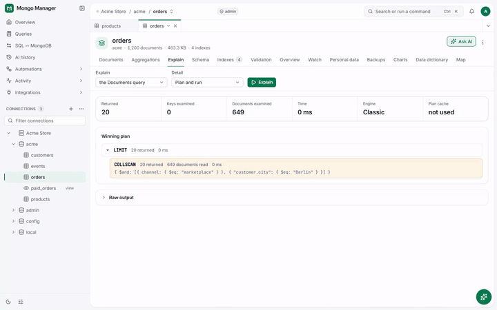</p>

### Conjuntos de réplicas

- **Veja os membros ao vivo:** o primário, os secundários, os membros inativos e o atraso de replicação, com sete dias de histórico.
- **Alertas de atraso:** quando o atraso de replicação passa de um limite, no app, por e-mail ou por webhook.
- **Acompanhe as alterações ao vivo:** o change stream de uma coleção, de um banco de dados ou de uma conexão inteira, com filtros, pausa e os valores anteriores a uma alteração quando o servidor os mantém.
- **Sincronização em tempo real:** uma cópia contínua de um conjunto de réplicas para outra conexão, verificada, terminando com uma virada (cutover).
- **Na Visão geral:** o estado do conjunto de réplicas em um widget próprio.

### Clusters fragmentados

Conecte-se a um mongos e gerencie o sharding de dentro do app:

- **Em um relance:** os shards, o estado do balanceador e como os chunks de cada coleção se distribuem entre os shards.
- **Fragmente uma coleção:** a chave de shard escolhida é verificada primeiro, com sugestões. O plugin Shard Key Analyzer examina a chave mais a fundo.
- **Zonas:** adicione shards a zonas ou remova-os e defina intervalos de chaves.
- **Balanceador:** ligue ou desligue e defina os horários em que ele roda.
- **O plano de consulta** mostra o plano de cada shard; change streams e a sincronização em tempo real também funcionam em clusters fragmentados.

### Equipes, segurança e auditoria

- **Modo equipe (`--auth`):** funções de administrador, editor e leitor, e acesso por conexão.
- **Login em dois fatores:** apps autenticadores, passkeys e códigos de recuperação; exigido de uma pessoa, dos administradores ou de todos.
- **Acesso ao painel:** faça o painel responder só a alguns endereços, configurado no próprio app; endereços que continuam falhando no login são bloqueados.
- **Log de auditoria:** somente para acréscimo (append-only) e encadeado por hash; exportado como CSV ou NDJSON.
- **Segredos criptografados:** senhas e chaves de conexão são criptografadas em disco; o shell roda em um processo em sandbox que não guarda nenhuma credencial.

### Backups, cópias e sincronização em tempo real

- **Backups:** arquivos do mongodump ou arquivos `.mmbak` criptografados (AES-256-GCM); agendados, com retenção, e enviados para uma pasta do servidor, armazenamento compatível com S3, Google Drive ou WebDAV.
- **Restaurações:** primeiro um plano e uma simulação, depois a sua confirmação.
- **Copiar e comparar:** uma coleção, os resultados de uma consulta ou um banco de dados, para a mesma conexão ou para outra, e comparados.
- **Sincronização em tempo real:** copia as alterações continuamente, verifica e termina com uma virada (cutover).

### Ocultar dados pessoais

Regras que ocultam campos pessoais de quem não pode vê-los: em documentos, consultas, agregações, exportações, cópias, backups, feeds de alterações, sincronizações em tempo real e no assistente de IA. As regras rodam no servidor; essa pessoa nunca recebe o shell.

## Todos os recursos

Clique em um título para abrir os detalhes.

<details>
<summary><b>Navegar e editar</b></summary>

- Bancos de dados, coleções e visualizações; coleções limitadas (capped), de séries temporais e clusterizadas (com agrupamento (collation) padrão e pré/pós-imagens de change stream).
- Documentos em tabela, cartões (com uma árvore expansível) ou JSON; inserir, duplicar, edições in-line que gravam apenas o que mudou e ações sobre uma seleção.
- Buckets do GridFS: listar, visualizar, enviar, baixar, metadados e excluir.

</details>

<details>
<summary><b>Consultas, pipelines e o shell</b></summary>

- Um filtro com autocompletar de campos e um construtor visual; projeção, ordenação, ignorar, limite, agrupamento (collation), hint e limite de tempo.
- Atualizações e exclusões em massa mostram quantos documentos correspondem e alguns antes e depois, sem gravar; pedem o nome da coleção quando todos os documentos seriam afetados.
- Um construtor de agregações: cartões de etapa ou modo de texto, uma prévia ao vivo de cada etapa em uma amostra, `$out`/`$merge` somente após uma confirmação.
- Exportação para código: Node.js, Python, Java, Go, C#, PHP, Ruby e Rust.
- A página Consultas (Ctrl+Shift+L): favoritos, pipelines salvos, snippets do shell e histórico; compartilháveis no modo equipe.
- Um shell avançado: mongosh por aba, em um processo em sandbox que não guarda nenhuma credencial; limites de somente leitura aplicados no servidor e todo comando no log de auditoria.

</details>

<details>
<summary><b>Índices, esquema e planos de consulta</b></summary>

- Todos os tipos de índice (simples, composto, multichave, de texto, 2d, 2dsphere, hashed, curinga) e todas as opções (único, esparso, parcial, TTL, agrupamento, oculto), com o uso de `$indexStats`.
- Índices do Atlas Search e do Vector Search (Atlas, ou MongoDB 8.0+ com mongot).
- "Por que está lenta?": o plano de consulta como uma árvore com avisos, e o índice que ajudaria, já preenchido.
- Análise de esquema: tipos de campo, com que frequência cada um aparece, histogramas e os valores mais comuns; um clique adiciona um filtro, e os locais aparecem em um mapa offline.
- O esquema exportado como Mongoose, JSON Schema, TypeScript, Pydantic, Go ou C#; regras de validação geradas a partir de uma amostra e testadas contra os documentos existentes.

</details>

<details>
<summary><b>Desempenho, alertas e a Visão geral</b></summary>

- Gráficos ao vivo de operações, conexões, rede e memória por conexão, com sete dias de histórico.
- As operações em execução mais lentas (administradores de conexão podem encerrá-las), as coleções mais movimentadas, o profiler, consultas lentas e sugestões de índices.
- Alertas: limites para conexões, operações, atraso de replicação, cache do WiredTiger, disco e operações lentas; eventos de backups e tarefas com falha e de sincronizações em tempo real paradas. Adiar, reconhecer e histórico.
- A Visão geral: um painel que cada usuário organiza para si.

</details>

<details>
<summary><b>Importar e exportar</b></summary>

- CSV, TSV, JSON, NDJSON (Extended JSON) e Excel (.xlsx), inclusive compactados com gzip; mapeamento de campos, tipos, inserir, upsert ou mesclar, uma simulação e um arquivo com os registros recusados.
- SQL ↔ MongoDB: dumps do mysqldump, pg_dump e sqlite3 para coleções; coleções exportadas como PostgreSQL, MySQL ou SQLite.

</details>

<details>
<summary><b>Conexões e criptografia</b></summary>

- TLS, túneis SSH com fixação da chave do host, SCRAM, X.509, LDAP (PLAIN), AWS IAM, MONGODB-OIDC e Kerberos.
- Conexões somente leitura, grupos e cores; importação e exportação protegidas por senha.
- Criptografia no lado do cliente: CSFLE e Queryable Encryption com chaves locais, AWS, Azure, Google Cloud e KMIP (no pacote npm).

</details>

<details>
<summary><b>Plugins</b></summary>

- Abas, ações de documento, visualizações de célula e páginas em sandbox; cada um é ativado após uma verificação de segurança e a aprovação de um administrador.
- Incluídos: um mapa GeoJSON, gráficos, um dicionário de dados, um localizador de duplicatas, comparações de documentos, saúde do esquema, SQL para MongoDB, o Shard Key Analyzer e mais.
- Outros são instalados a partir de um arquivo ou, em um servidor que permita, de um repositório do GitHub.

</details>

<details>
<summary><b>Em todo lugar</b></summary>

- Dez idiomas: inglês, turco, chinês, japonês, espanhol, português, coreano, alemão, francês e russo.
- Temas claro e escuro, cores de destaque, uma paleta de comandos (Ctrl+K), atalhos de teclado (?) e a documentação dentro do app.
- Tarefas em segundo plano com progresso ao vivo; instalável como app (PWA), em sua própria janela.

</details>

## Um tour rápido

### Encontre e filtre

Digite um filtro com preenchimento de campos ou clique em um valor para adicioná-lo; os resultados são paginados em tabela, cartões ou JSON.

<p align="center">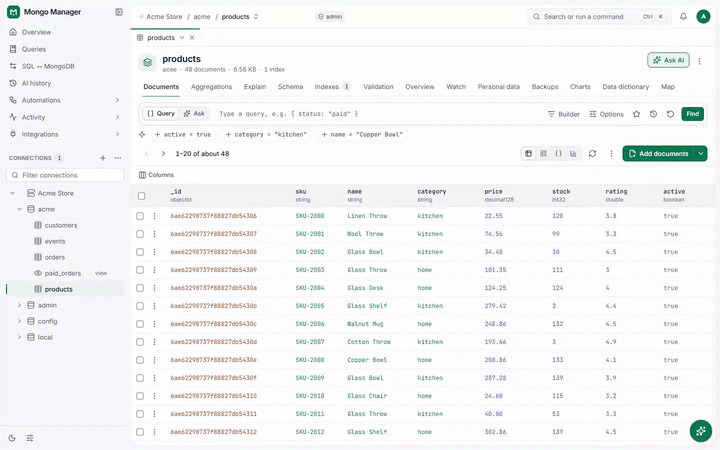</p>

### Monte pipelines etapa por etapa

Cada etapa mostra sua saída em uma amostra enquanto você digita; execute, salve ou exporte para código.

<p align="center">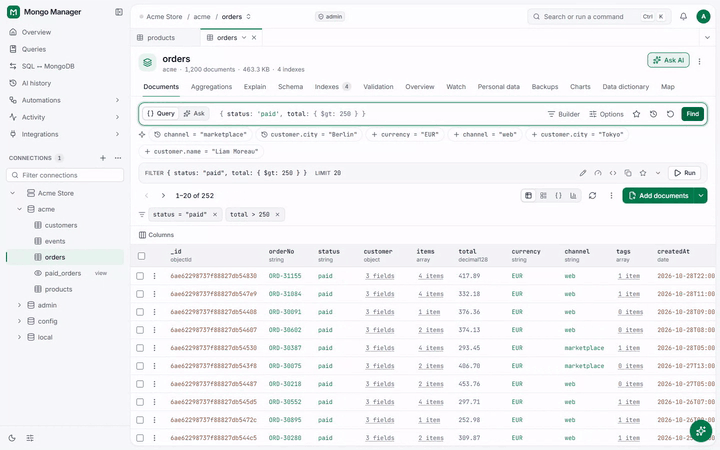</p>

### Conheça a forma dos seus dados

Uma análise por amostragem de cada campo: seus tipos, com que frequência aparece e seus valores.

<p align="center">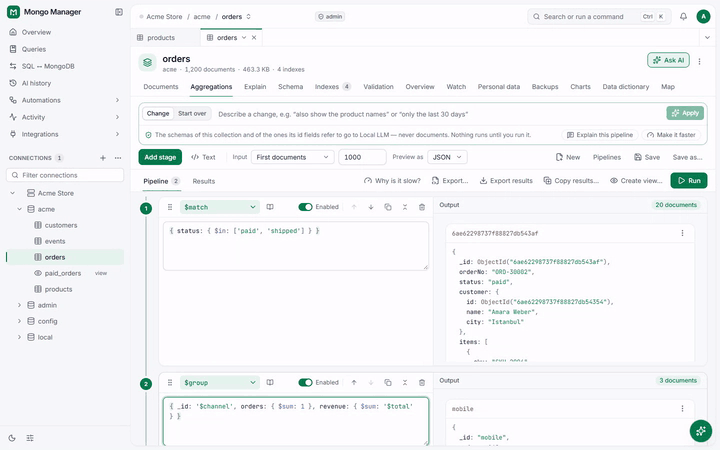</p>

### Veja por que uma consulta está lenta

O plano da consulta como uma árvore, com a etapa que leu a coleção inteira e o índice que ajudaria.

<p align="center">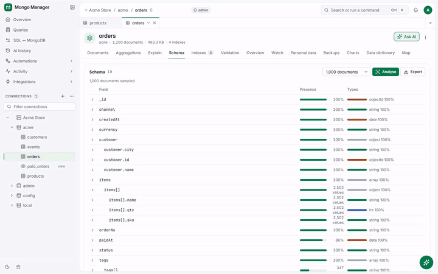</p>

### Tudo a uma tecla

A paleta de comandos (Ctrl+K) encontra qualquer comando, coleção ou configuração.

<p align="center">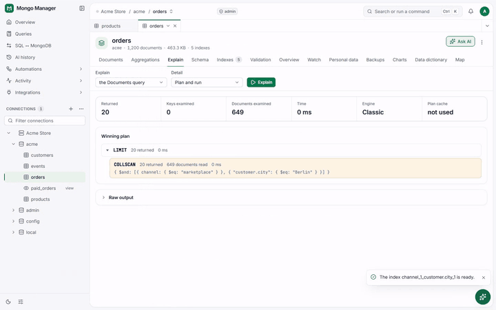</p>

### Acompanhe o servidor ao vivo

Operações, conexões, rede e memória, ao vivo e ao longo de sete dias, com alertas.

<p align="center">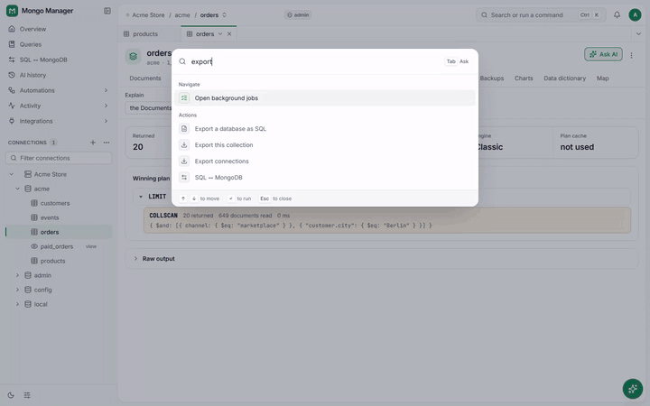</p>

## Capturas de tela

As imagens seguem o seu tema do GitHub: claro ou escuro.

<table>
  <tr>
    <td colspan="2"><picture><source media="(prefers-color-scheme: dark)" srcset="site/assets/screens/ai-agent-dark.png">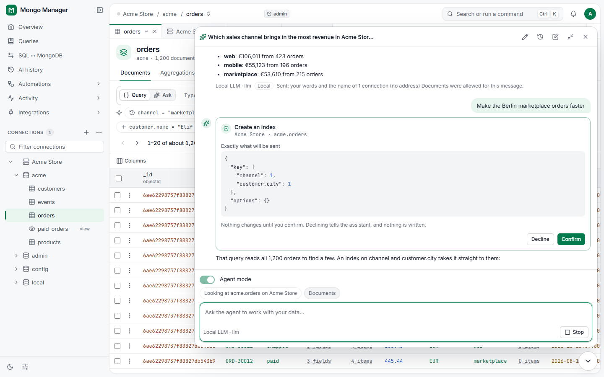</picture><br><sub>O agente de IA: uma resposta a partir dos dados e um índice aguardando confirmação</sub></td>
  </tr>
  <tr>
    <td><picture><source media="(prefers-color-scheme: dark)" srcset="site/assets/screens/documents-dark.png">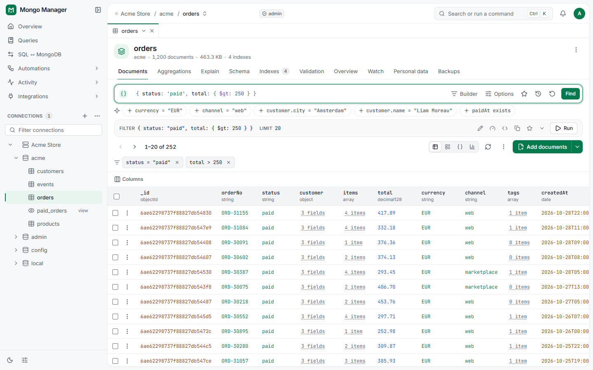</picture><br><sub>Documentos em uma tabela, com um filtro e sugestões em um clique</sub></td>
    <td><picture><source media="(prefers-color-scheme: dark)" srcset="site/assets/screens/aggregation-dark.png">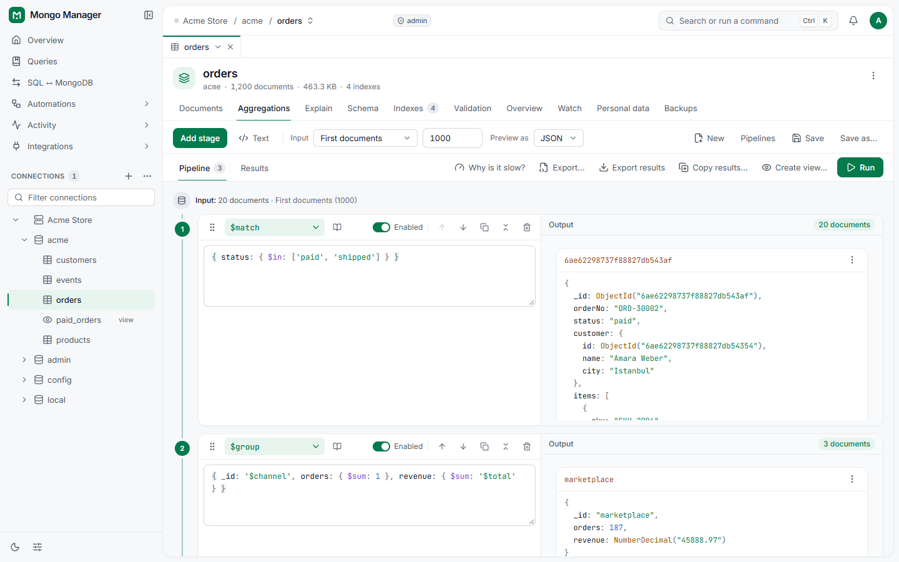</picture><br><sub>Um pipeline de agregação, com a prévia de cada etapa</sub></td>
  </tr>
  <tr>
    <td><picture><source media="(prefers-color-scheme: dark)" srcset="site/assets/screens/schema-dark.png">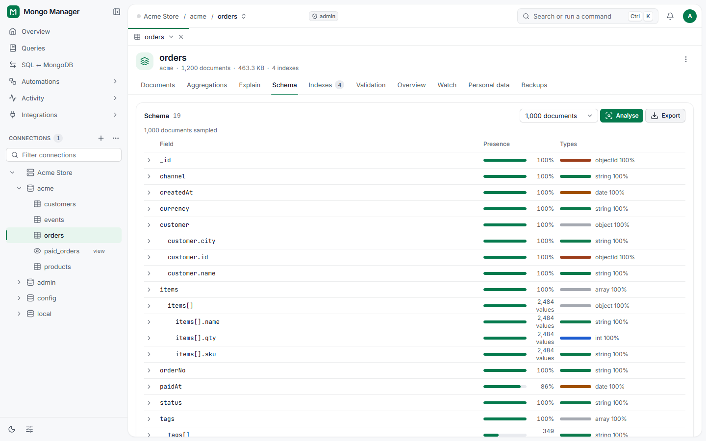</picture><br><sub>O esquema de uma coleção amostrada</sub></td>
    <td><picture><source media="(prefers-color-scheme: dark)" srcset="site/assets/screens/explain-dark.png">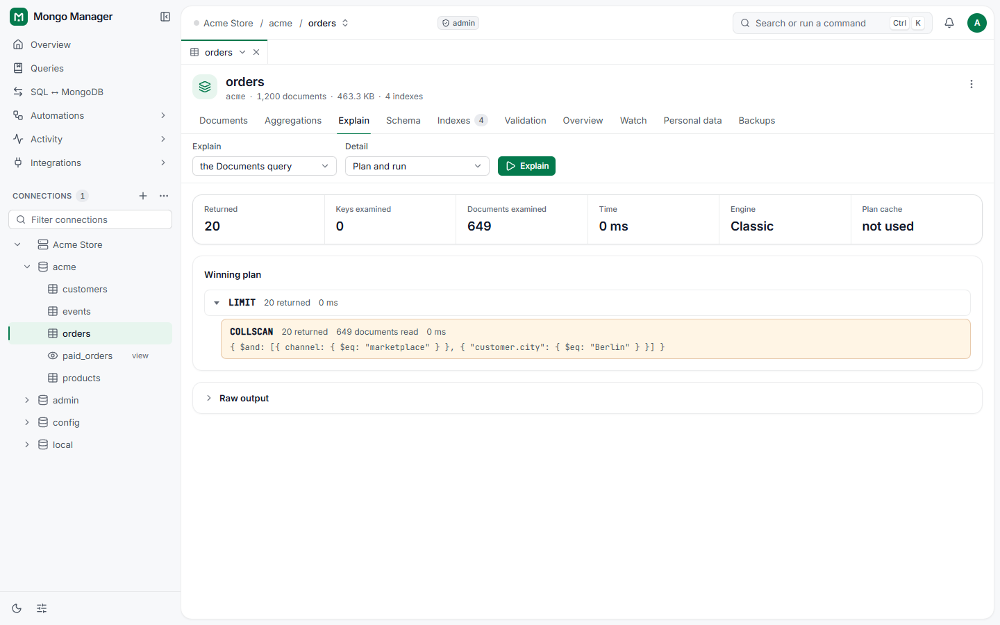</picture><br><sub>Por que está lenta? O plano da consulta</sub></td>
  </tr>
  <tr>
    <td><picture><source media="(prefers-color-scheme: dark)" srcset="site/assets/screens/performance-dark.png">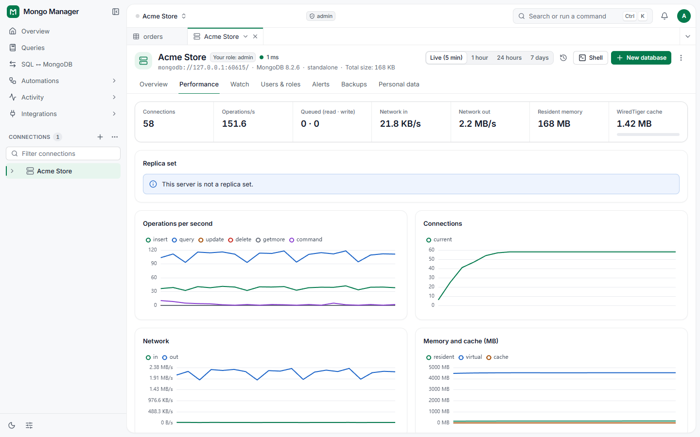</picture><br><sub>O desempenho do servidor ao vivo</sub></td>
    <td><picture><source media="(prefers-color-scheme: dark)" srcset="site/assets/screens/palette-dark.png">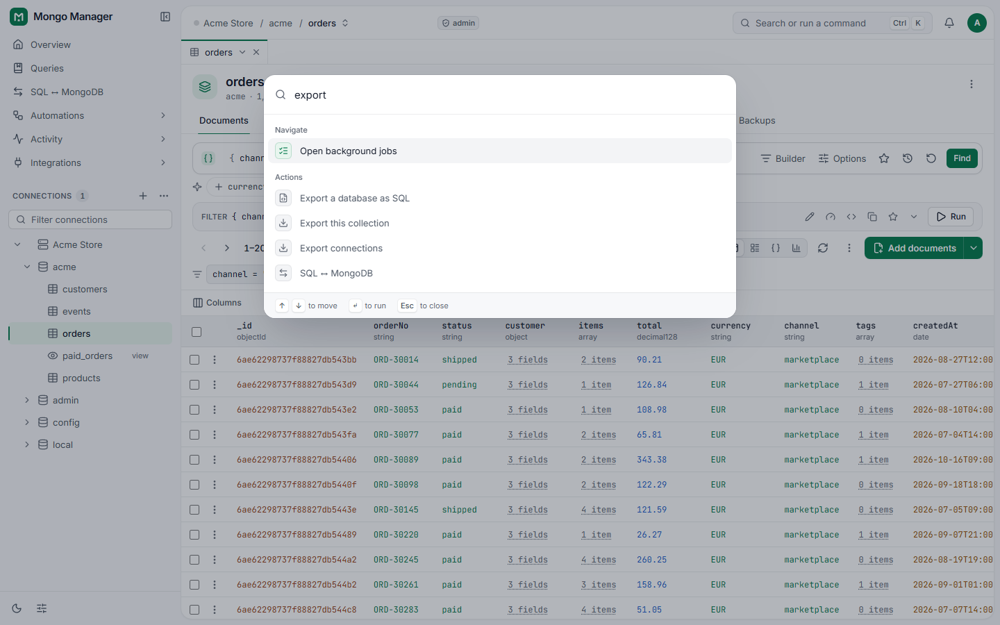</picture><br><sub>A paleta de comandos (Ctrl+K)</sub></td>
  </tr>
  <tr>
    <td><picture><source media="(prefers-color-scheme: dark)" srcset="site/assets/screens/plugins-dark.png">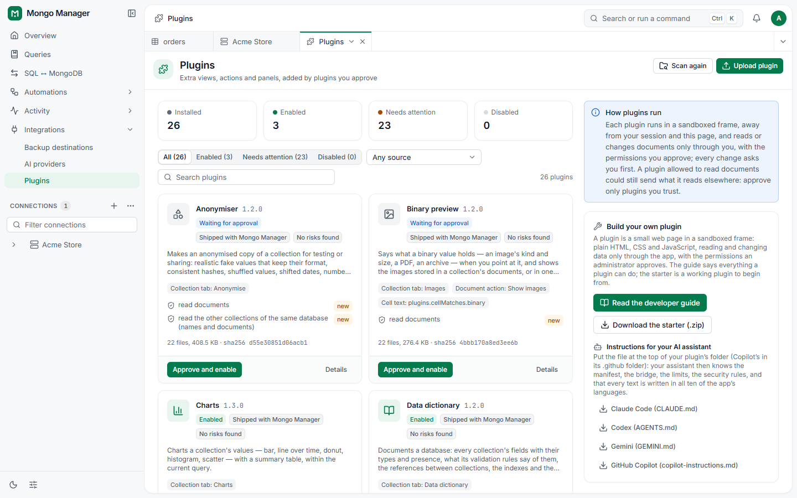</picture><br><sub>Plugins, cada um aprovado por um administrador</sub></td>
    <td><picture><source media="(prefers-color-scheme: dark)" srcset="site/assets/screens/security-dark.png">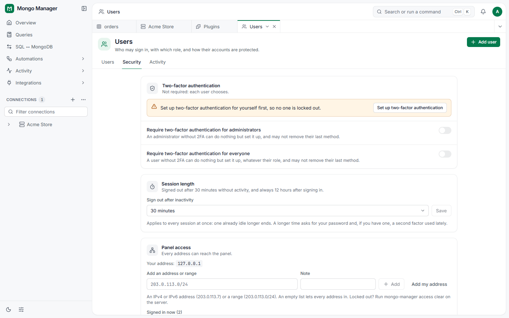</picture><br><sub>Modo equipe: regras de dois fatores, sessões, acesso ao painel e bloqueios de entrada</sub></td>
  </tr>
</table>

## Instalação

Escolha uma. Cada release traz todos os arquivos com checksums SHA-256 (`SHA256SUMS`); todas as formas funcionam também em uma máquina sem acesso à internet.

| Forma                        | Comando                                                                                               | Requer             |
| ---------------------------- | ----------------------------------------------------------------------------------------------------- | ------------------ |
| npm                          | `npx @mongo-manager/app`, ou `npm install --global @mongo-manager/app`                                          | Node.js 24+        |
| npm, offline                 | `npm install --global ./mongo-manager-<version>.tgz`                                                  | Node.js 24+        |
| Binário independente         | baixe `mongo-manager-<version>-<os>-<arch>` e execute-o                                               | nada               |
| Docker                       | `docker run -d -p 127.0.0.1:4321:4321 -v mm-data:/data ghcr.io/mongo-manager/mongo-manager:<version>` | Docker             |
| Docker, offline              | `docker load -i mongo-manager-<version>-<arch>.tar` e depois execute `mongo-manager:<version>`        | Docker             |
| Docker, a partir de um clone | `docker compose -f deploy/docker-compose.yml up -d` (compila a imagem a partir do código-fonte)       | Docker             |
| Serviço do sistema           | `sudo mongo-manager service install` (Windows: em um prompt com privilégios elevados)                 | o npm ou o binário |

- **Os binários independentes** (Linux x64/arm64, Windows x64, macOS arm64) trazem seu próprio runtime e o app web. Eles não são assinados digitalmente; no macOS, permita o binário em _Ajustes do Sistema → Privacidade e Segurança_ ou execute `xattr -d com.apple.quarantine ./mongo-manager-*`.
- **Kerberos e a criptografia no lado do cliente** funcionam apenas no pacote npm (instale `kerberos` e `mongodb-client-encryption` junto a ele).
- **MongoDB compatível:** 6.0 e posteriores; servidores standalone, conjuntos de réplicas, clusters fragmentados (por meio do mongos) e Atlas. Acompanhar alterações e a sincronização em tempo real exigem um conjunto de réplicas ou um cluster fragmentado. Servidores mais antigos são recusados com uma mensagem que informa isso.
- **Testes:** os testes do servidor rodam contra servidores e conjuntos de réplicas reais 6.0, 7.0, 8.0 e 8.3. Clusters fragmentados são testados com respostas gravadas do mongos, e o Atlas por meio de suas strings de conexão; nenhum dos dois contra uma implantação real.
- Serviços, Docker, proxies reversos e backups: [deploy/README.md](deploy/README.md).

**Docker**

- A imagem roda em modo equipe e escuta em todos os endereços dentro do contêiner. Abra `http://127.0.0.1:4321` e informe o token de configuração de uso único que `docker exec <name> cat /data/setup-token` mostra; conclua a configuração imediatamente.
- Atrás de um proxy reverso com nome de domínio, defina `MM_ALLOWED_HOSTS` com esse nome (senão a resposta é `403 Host not allowed`) e `MM_TRUSTED_PROXIES` com o gateway da rede do Docker, geralmente `172.17.0.1`: veja [deploy/README.md](deploy/README.md#docker).
- Dentro do contêiner, `localhost` é o próprio contêiner: para alcançar um MongoDB no host ou em outro contêiner, veja [Alcançar o MongoDB a partir do contêiner](deploy/README.md#reaching-your-mongodb-from-the-container).

## Uso

```sh
mongo-manager                 # local mode on http://127.0.0.1:4321, opens your browser
mongo-manager open            # a new one-time link that opens a running local-mode Mongo Manager
mongo-manager --auth          # team mode; the first start prints a one-time setup token
mongo-manager --help          # every command and option
mongo-manager doctor          # check the installation and the data directory
```

Toda opção do servidor também tem uma variável de ambiente `MM_*`, por exemplo `MM_WEB_PORT`, `MM_AUTH=1` ou `MM_DATA_DIR`. Os demais comandos gerenciam usuários, chaves, backups e o serviço do sistema; `mongo-manager --help` lista todos eles.

## Segurança

<details>
<summary><b>Como o Mongo Manager se protege</b></summary>

- **Endereço de escuta:** somente este computador (loopback) por padrão. O Mongo Manager recusa um endereço de rede, ou um proxy reverso na frente, sem `--auth` (a menos que seja iniciado com o perigoso `--unsafe-no-auth`). Sem `--allowed-hosts`, um endereço de rede responde somente a endereços IP e a `localhost` (contra DNS rebinding).
- **Modo local:** abre somente a partir de um link de uso único; `mongo-manager open` gera um novo. Cada navegador passa então a ter um cookie HttpOnly próprio e uma chave de página; `mongo-manager forget-browsers` desconecta todos eles.
- **Segredos salvos:** senhas e chaves de conexão são criptografadas com `secret.key` (ou `MM_SECRET_KEY`). Faça backup da chave junto com o diretório de dados, mas guarde os dois separadamente; `mongo-manager rotate-key` substitui a chave.
- **Proteção da web:** uma Content-Security-Policy estrita, tokens CSRF e verificações de origem, login com limitação de taxa e sessões que se encerram por inatividade e após 12 horas; alterações sensíveis pedem de novo a sua senha ou o seu segundo fator.
- **Permissões:** toda verificação de somente leitura e de função é executada no servidor, nunca apenas no navegador.

</details>

Se você encontrar uma vulnerabilidade, não abra uma issue pública; relate-a de forma privada: [SECURITY.md](SECURITY.md).

## Desenvolvimento

```sh
pnpm install
pnpm dev:web                  # the web app with hot reload; /api goes to a server on port 4321
                              # (local mode: open its launch link with port 5173 in place of 4321)
pnpm lint && pnpm typecheck && pnpm test
pnpm build                    # web app, plugins and the bundled CLI in packages/cli
pnpm test:e2e                 # Playwright against the installed Chrome
pnpm --filter @mongo-manager/e2e e2e:rs  # after pnpm build: Watch and Live sync on the memory
                              # server's replica set, failing without one (as CI runs them);
                              # MM_E2E_PORT=45000 picks another port for the test server
pnpm --filter @mongo-manager/app test:sea   # build and run the standalone binary
node packages/server/scripts/capture-explain.mjs --version 7.0.43   # explain fixtures of a release;
                              # --sharded --bin <folder with mongod and mongos> for a sharded cluster
```

| Pacote             | O que é                                                            |
| ------------------ | ------------------------------------------------------------------ |
| `packages/shared`  | Tipos, esquemas, o parser de consultas seguro, EJSON               |
| `packages/server`  | API Fastify, autenticação, armazenamento SQLite, acesso ao MongoDB |
| `packages/web`     | App web em Vue 3                                                   |
| `packages/cli`     | O comando `mongo-manager`, instalador do serviço                   |
| `packages/plugins` | Plugins incluídos e o kit de plugins                               |
| `packages/e2e`     | Testes de ponta a ponta                                            |

## Licença

O Mongo Manager é licenciado sob a [Licença Creative Commons Atribuição-NãoComercial-CompartilhaIgual 4.0 Internacional (CC BY-NC-SA 4.0)](LICENSE):

- **Atribuição:** dê crédito a Gokhan OZGEZER ao usar ou compartilhar.
- **NãoComercial:** não use para fins comerciais.
- **CompartilhaIgual:** compartilhe o que você alterar ou criar a partir dele sob a mesma licença.

Os componentes de terceiros incluídos mantêm suas próprias licenças; cada release os lista em `THIRD-PARTY-NOTICES.txt`. Dúvidas sobre uso comercial: [gokhanozgezer@gmail.com](mailto:gokhanozgezer@gmail.com).

## Autor

**Gokhan OZGEZER**

- E-mail: [gokhanozgezer@gmail.com](mailto:gokhanozgezer@gmail.com)
- GitHub: [@gokhanozgezer](https://github.com/gokhanozgezer)
- Projeto: [github.com/mongo-manager/mongo-manager](https://github.com/mongo-manager/mongo-manager)
- Bugs e ideias: [Issues](https://github.com/mongo-manager/mongo-manager/issues)
